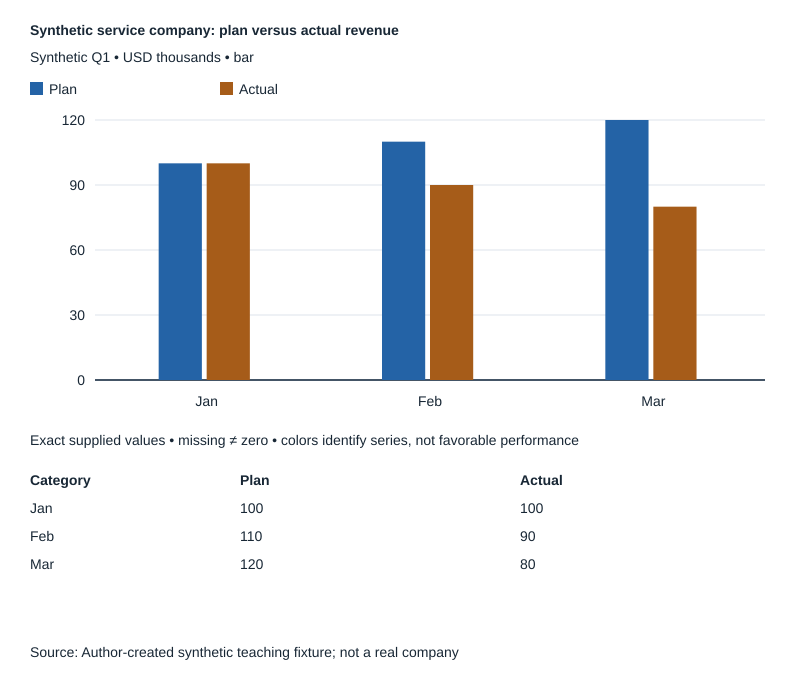

# Product Decision Skills

**By [Ksenia Vorobeva](https://github.com/Flysparrowx)**

**Understand your customers. Analyze your business. Make better decisions.**

Three independent, open-source AI Agent Skills for product leaders, founders and consultants:

- **[CPO Product Strategist](skills/cpo-product-strategist/SKILL.md)** — compare product strategies, business models and economics; turn evidence into a decision brief.
- **[Data Visualization & BI](skills/data-visualization-bi/SKILL.md)** — turn supplied data into readable charts and dashboard specifications; includes a local SVG renderer.
- **[Microgroup Context Intelligence](skills/microgroup-context-intelligence/SKILL.md)** — understand a specific audience's practices, language and trust; return sourced observations, hypotheses and research gaps.

Install one skill or use the collection when a decision needs more than one perspective.

[По-русски](README.ru.md) · [Skill cards](SKILL-CARDS.md) · [Inputs and saved outputs](examples/README.md)

## See it in action

**Request:** “Explain the revenue miss. Should we increase acquisition spending or review capacity?”

**Analysis:** In this synthetic Q1 fixture, revenue is **270 vs 330 planned** (USD thousands): **60 below plan, or 18.18%**. Supplied monthly operating profit is **20 → 0 → −10**.



**Decision:** Check lost orders and onboarding throughput before increasing acquisition spend. The supplied backlog note suggests a capacity hypothesis; it does **not** prove the cause of the revenue miss.

[Full-size chart](demos/company-analysis/revenue.svg) · [Data, profit chart and decision rationale](demos/company-analysis/README.md)

All figures are synthetic teaching data. This is an authored CPO + BI demonstration, not a recording of automatic multi-agent execution.

More examples: [Product strategy — email or SMS reminders](examples/cpo/output.md) · [Audience discovery — observations and contradictions](demos/audience-discovery/README.md).

## Quick install

From your project's terminal, install all three for Codex:

```sh
DISABLE_TELEMETRY=1 npx skills add \
  Flysparrowx/product-decision-skills-public \
  --skill '*' --agent codex --yes --copy
```

This copies complete skill folders into your project's `.agents/skills/`. It does not use a global install. Node.js/npm and Git are needed for the CLI; Python 3 is needed only for the bundled local tools.

[Install just one skill or use the release ZIP ↓](#install-one-skill-or-all-three)

## How the skills work together

- **CPO → BI:** when you request visualization, or a quantitative company analysis benefits from a chart.
- **CPO → Microgroup:** when the context of a specific audience can change the product decision.
- **All three:** when the choice needs strategy, quantitative visualization **and** audience research. See the [synthetic strategic decision](demos/strategic-decision/README.md).

Each skill also works independently. CPO interprets the business decision; BI handles chart design and construction; Microgroup returns observations, sources, hypotheses, contradictions and limitations. Qualitative observations are not representative statistics.

These are collaboration instructions. Automatic selection and companion invocation depend on your host; installing the folders does not guarantee automatic orchestration.

## Install one skill or all three

The [Vercel Skills CLI](https://github.com/vercel-labs/skills) discovered all three skills and installed each separately and together in isolated Codex projects. Verified with **Skills CLI 1.7.2 on 2026-10-14**: manifests, references and scripts matched the repository files byte for byte; the installed chart renderer and research validator were checked separately.

List available skills without installing:

```sh
DISABLE_TELEMETRY=1 npx skills add \
  Flysparrowx/product-decision-skills-public --list
```

Install only CPO:

```sh
DISABLE_TELEMETRY=1 npx skills add \
  Flysparrowx/product-decision-skills-public \
  --skill cpo-product-strategist --agent codex --yes --copy
```

Install only BI:

```sh
DISABLE_TELEMETRY=1 npx skills add \
  Flysparrowx/product-decision-skills-public \
  --skill data-visualization-bi --agent codex --yes --copy
```

Install only Microgroup:

```sh
DISABLE_TELEMETRY=1 npx skills add \
  Flysparrowx/product-decision-skills-public \
  --skill microgroup-context-intelligence --agent codex --yes --copy
```

Use the [quick-install command](#quick-install) for all three. For another supported agent, replace `codex` with its CLI identifier; only Codex project installation was tested here. Review existing skill folders before installing. `DISABLE_TELEMETRY=1` disables the CLI's anonymous usage telemetry.

These commands fetch the repository's default branch, which can change. They do not install the frozen v0.1.0 ZIP. Installation checks confirm files and local tools, not automatic skill activation in every host.

### Alternative: download the v0.1.0 ZIP

Download the [published v0.1.0 package](https://github.com/Flysparrowx/product-decision-skills-public/releases/download/v0.1.0/product-decision-skills-v0.1.0.zip), unzip it, and open a terminal in the extracted root:

```sh
project="$PWD/example project"
mkdir -p "$project/.agents/skills"
cp -R skills/cpo-product-strategist \
  skills/data-visualization-bi \
  skills/microgroup-context-intelligence "$project/.agents/skills/"
```

Change `project` to your own project path. For one skill, keep only its source folder in `cp -R`. The package includes `SHA256SUMS`. The published release and ZIP retain their original files and documentation; README improvements on `main` do not change that archive.

## Try a skill

```text
$cpo-product-strategist
Compare keeping email reminders with adding SMS. We have no evidence
about no-show causes or SMS costs yet. What can we decide now,
which economic conditions matter, and what evidence is missing?
```

```text
$data-visualization-bi
Create a static SVG from supplied monthly observations: January 10,
February missing, March 0, April -2. Preserve exact values and gaps.
```

```text
$microgroup-context-intelligence
Use these three supplied notes about an adult repair club: one member
prefers the organizer, another wants an app, and newcomers value meeting
in person. Separate observations, contradictions and hypotheses.
Do not invent interviews or claim how common these preferences are.
```

The [complete examples](examples/README.md) include synthetic inputs and saved outputs from earlier independent installed-skill executions. They are illustrations, not new evaluations or guarantees.

## Local tools and boundaries

From a repository checkout or the extracted package root:

```sh
python3 skills/data-visualization-bi/scripts/render_chart.py \
  examples/bi/supplied.json chart.svg
python3 skills/microgroup-context-intelligence/scripts/validate_research_run.py \
  demos/audience-discovery/research.json
```

The tools use Python's standard library. BI renders static bars or lines with missing, zero and negative values; [other chart forms and interactive dashboards](skills/data-visualization-bi/references/renderer-contract.md) need suitable tools. Microgroup's validator checks ledger integrity, not source authenticity or full schema compliance. Missing data remains missing; research hypotheses remain hypotheses.

## Author and licenses

Created by **Ksenia Vorobeva** for product leaders, entrepreneurs and consultants. [GitHub profile](https://github.com/Flysparrowx).

Her contributions are licensed under [Apache-2.0](LICENSE). The Strategy Red-Team adaptation retains its [MIT terms and copyright notice](THIRD-PARTY-NOTICES.txt). See [attribution](ATTRIBUTION.md) and the [publication notice](PUBLICATION-NOTICE.md) for provenance and its limits.

[Published release v0.1.0](https://github.com/Flysparrowx/product-decision-skills-public/releases/tag/v0.1.0). Documentation on the default branch may be newer than the immutable release package. A local rebuild from newer files is a development snapshot, not a recreation of the published ZIP.
