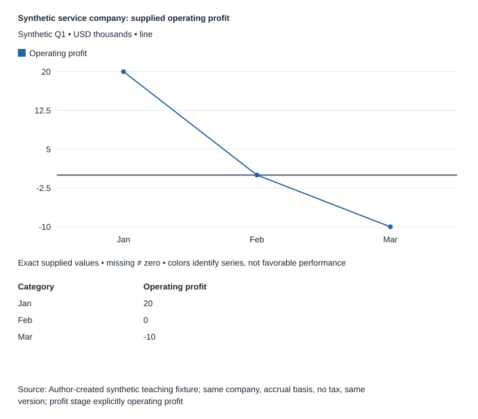

# Company Analysis — synthetic CPO + BI demonstration

All values below are synthetic teaching inputs. No real company or customer is represented.

Request: “Explain the company's revenue miss and choose between a blanket acquisition increase and a capacity review.” CPO frames the decision; BI is justified because plan/actual and profit comparisons could change spending. Microgroup is not justified: no niche trust/adoption context is supplied.

Facts within this fictional fixture: revenue plan is 100/110/120; actual is 100/90/80, all USD thousands, one company, Q1, one version. Supplied operating profit is 20/0/−10, same scope and accrual basis. Synthetic operational note: the company paused onboarding while its support backlog grew. That note is not a causal identification.

Strategic X-Ray: use one value-chain bottleneck diagnostic. Acquisition alone cannot resolve an onboarding constraint; the note supports examining capacity, but does not prove it caused every lost sale. Revenue totals 270 versus 330 plan, a 60 shortfall (18.18% below the nonzero plan). Operating profit totals 10, although the March observation is negative. Profit is supplied, not silently recalculated from unmatched costs. “Costs up” or “revenue down” is not itself a favorable/unfavorable verdict without goals and context.

Decision illustrated: confirm the request to investigate performance, but change the first action from blanket acquisition spending to checking lost orders and onboarding throughput. Evidence gate: same-cohort eligible orders, completed onboarding, support capacity and lost-order reasons in the observed Q1 window, from the responsible operations owner. If capacity did not bind, reconsider acquisition/channel explanations. No invented percentage improvement, deadline or ROI target is asserted.

Actual generated charts:




Reproduce from repository root:

```sh
python3 skills/data-visualization-bi/scripts/render_chart.py demos/company-analysis/data.json demos/company-analysis/revenue.svg
python3 skills/data-visualization-bi/scripts/render_chart.py demos/company-analysis/profit.json demos/company-analysis/profit.svg
```

These are static charts. They do not demonstrate filter interaction or automatic skill invocation.
