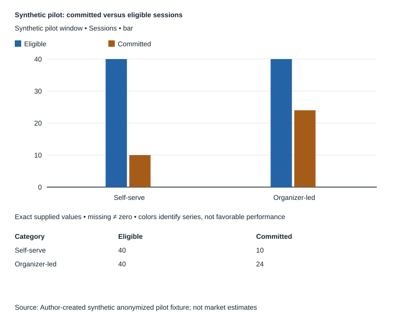

# Strategic Decision — synthetic CPO + BI + Microgroup demonstration

All inputs are fictional teaching fixtures. This is an authored integration example, not an observed live three-agent execution.

Request: “Choose a launch model for a local scheduling service, considering pilot performance, economics and trust.”

- CPO: compare self-service versus organizer-led launch; own the recommendation, trade-offs and evidence gate.
- BI: actual visual comparison is material. Synthetic pilot has 40 eligible sessions in each channel, with 10 versus 24 commitments. Denominators and observation window match; assignment method and comparability beyond these fields are unknown.
- Microgroup: the [synthetic source-linked context ledger](../audience-discovery/research.json) raises organizer trust and location concerns, plus a self-service counterexample. This context could alter onboarding and distribution.

Observations within the fixture: commitment rates are 25% and 60%. The 35 percentage-point difference is descriptive, not evidence of a causal treatment effect: no randomized allocation or common participant mix is supplied. Qualitative trust observations cannot prove that difference's cause or its population prevalence.

Strategic X-Ray uses one mechanism: channel trust may affect commitment, while organizer time may constrain scalability. It changes the next decision from “launch organizer-led everywhere” to “run a bounded comparison with measured organizer cost and participant-mix controls.” It does not manufacture a conflict with the user's original launch question.

Economic boundary: choose organizer-led only if incremental retained contribution exceeds incremental organizer/acquisition cost under acceptable privacy/quality constraints. Revenue per retained session, retention, variable cost, organizer time/cost and cash exposure are unknown: no ROI or profit is invented. The smallest first-fill set is retained contribution per committed session and incremental organizer cost for the same window; those unlock a first contribution comparison, not a forecast. Longer-run retention/capacity and counterfactual selection follow.

Decision illustrated: test organizer-assisted onboarding in a bounded authorized pilot while keeping a self-service path for the minority preference. Decision owner sets exposure and success thresholds from actual costs and acceptable downside. Evidence gate: same-window first-party commitment, retained outcomes and cost/time data by channel, plus consented participant validation of trust hypotheses. Revisit if cost exceeds incremental value, trust hypothesis fails or access constraints prevent measurement. No external launch is authorized by this recommendation.
